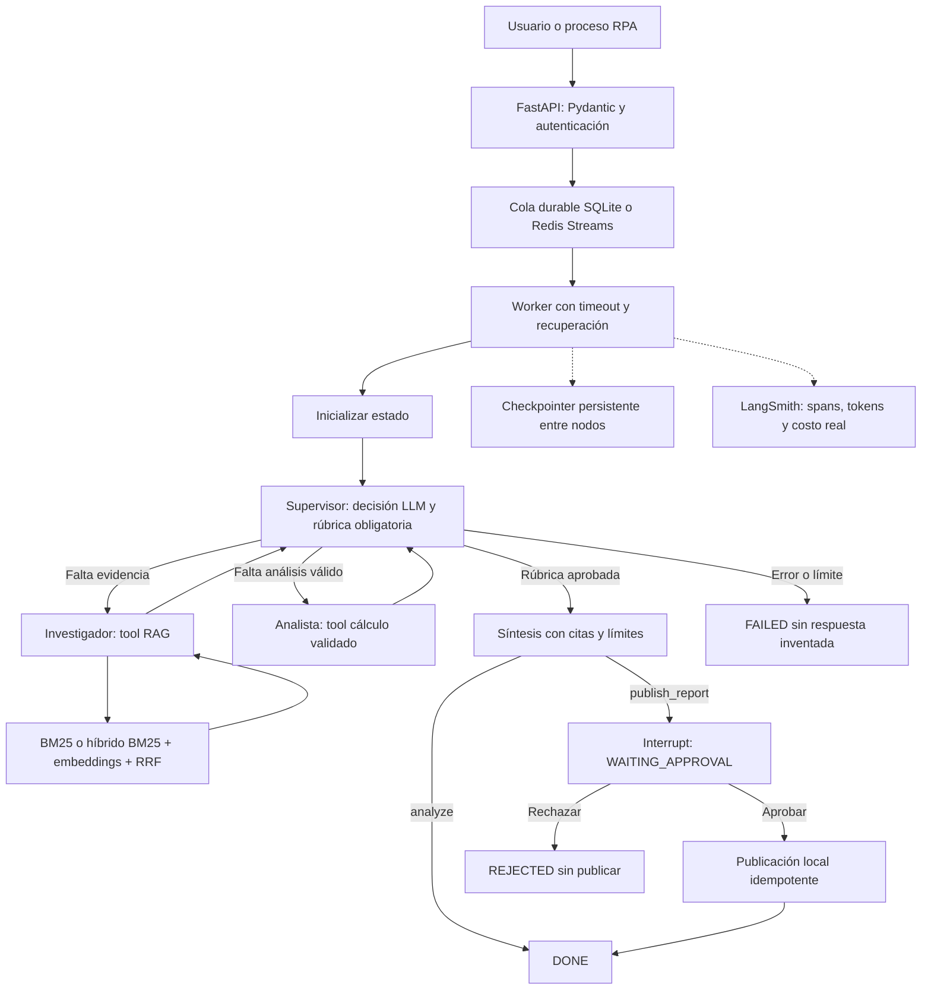

# Intelligence System: análisis de automatización RPA

Sistema de IA que recibe una consulta por FastAPI, recupera evidencia documental y coordina un investigador y un analista mediante un supervisor LangGraph. El supervisor comprueba fuentes, versiones y cálculos antes de producir una respuesta con citas. Cada intervención tiene checkpoint persistente y trazas LangSmith. La publicación del informe exige aprobación humana autenticada.

Entrega final de AI Engineering, Python **3.12+**. Integra y refactoriza las preentregas propias de los módulos 3–7. No necesita otros repositorios locales.

**Dominio de demostración:** tres pilotos RPA **simulados** de facturas, conciliación y reportes. No son datos empresariales ni estimaciones de ahorro monetario. Una consulta fuera del corpus termina sin declarar una respuesta exitosa.

## Arranque con una instrucción

Requisitos: Python 3.12 con `venv` y acceso a PyPI. Windows necesita el lanzador `py`; Linux/macOS, `python3.12`.

```powershell
# Windows, dentro del repositorio
.\run.ps1
```

```sh
# Linux / macOS
sh run.sh
```

El script instala dependencias, crea `.env` con dos claves aleatorias y levanta API y worker separados. El primer arranque usa SQLite y modo offline: no consume API ni requiere credenciales externas. Consultar `API_KEY` y `APPROVAL_KEY` en el `.env` local. Si PowerShell restringe scripts, usar una política autorizada por la organización.

- Swagger/OpenAPI: <http://127.0.0.1:8000/docs>
- Salud: <http://127.0.0.1:8000/health>
- `Ctrl+C` detiene ambos servicios. Los archivos en `data/` conservan tareas y checkpoints.

Para reproducir las versiones probadas: instalar `requirements-lock.txt` dentro de un entorno virtual Python 3.12. El lock proviene de Windows; Docker instala las dependencias portables de `requirements.txt`.

## Grafo de agentes



La síntesis es determinista y utiliza exclusivamente los cálculos y documentos recuperados. En modo `llm`, supervisor y especialistas usan el modelo real para decidir rutas e invocar herramientas; las decisiones no pueden eludir la rúbrica. En modo `offline`, las mismas reglas operan sin LLM.

## API y ejemplo

```powershell
$config = Get-Content .env | ConvertFrom-StringData
$headers = @{ 'X-API-Key' = $config.API_KEY }
$body = @{ query='Investiga pilotos RPA y calcula ahorro mensual'; action='analyze' } | ConvertTo-Json
$job = Invoke-RestMethod http://127.0.0.1:8000/tasks -Method Post -Headers $headers -ContentType application/json -Body $body
Invoke-RestMethod "http://127.0.0.1:8000/tasks/$($job.job_id)" -Headers $headers
```

| Método y ruta | Contrato |
|---|---|
| `GET /health` | 200 con salud del almacenamiento |
| `POST /tasks` | 202 con UUID y estado. Consulta de 1–4000 caracteres |
| `GET /tasks/{job_id}` | Estado, resultado o tipo de error sanitizado |
| `POST /tasks/{job_id}/approve` | 202, `{"approved":true}` o `false`; ambas claves requeridas |

Publicar significa guardar el informe localmente, no enviar correos ni cambiar aplicaciones externas. Para probar HITL, crear una tarea con `action=publish_report`, consultar hasta `WAITING_APPROVAL`, revisar `result` y luego:

```powershell
$headers['X-Approval-Key'] = $config.APPROVAL_KEY
Invoke-RestMethod "http://127.0.0.1:8000/tasks/$($job.job_id)/approve" -Method Post -Headers $headers -ContentType application/json -Body '{"approved":true}'
```

Errores: 401 clave API, 403 aprobación, 404 UUID inexistente, 409 aprobación repetida o prematura, 422 contrato inválido, 503 Redis indisponible. Los endpoints tienen modelos de entrada y salida Pydantic. No incluir credenciales en consultas.

## LLM real, RAG y observabilidad

Editar `.env` y reiniciar los servicios:

```dotenv
AGENT_MODE=llm
LLM_PROVIDER=anthropic
ANTHROPIC_API_KEY=<clave propia>
ANTHROPIC_MODEL=<modelo habilitado en tu cuenta>
LANGSMITH_TRACING=true
LANGSMITH_API_KEY=<clave propia>
LANGSMITH_PROJECT=intelligence-final
```

También admite OpenAI con `LLM_PROVIDER=openai`, `OPENAI_API_KEY` y `OPENAI_MODEL`. Los nombres de modelo se configuran en entorno, no en el código. Los SDK usan `.ainvoke()` y timeout/reintentos acotados.

El RAG predeterminado usa **BM25**, evidencia estructurada y citas. Cada piloto es una unidad documental atómica; no se fragmentan números de su fuente. `CORPUS_PATH` permite un corpus alternativo con el mismo esquema. Se valida identidad, duplicados, números finitos, tiempos y volumen. El snapshot se carga al arrancar la recuperación y cambia al reiniciar el worker.

Para **híbrido**: `RETRIEVAL_MODE=hybrid`, `EMBEDDING_API_KEY` y `EMBEDDING_MODEL`. Usa embeddings OpenAI por `httpx.AsyncClient`, similitud coseno con umbral configurable `SEMANTIC_MIN_SCORE` y Reciprocal Rank Fusion con BM25. No requiere Pinecone ni IDs fijos. Los vectores se cachean en memoria por worker y se reconstruyen al reiniciar; no se presenta como índice de gran escala. El modo híbrido tiene pruebas con transporte simulado; la corrida real de esta entrega usa BM25 y Anthropic.

```powershell
.venv\Scripts\python.exe scripts/load_test.py
```

El script envía cinco tareas por HTTP, consulta sus estados y guarda IDs y tiempos en `output/load_test.json`. En LangSmith, abrir el proyecto configurado y comprobar **cinco trazas raíz** `task_execution`, sus nodos, llamadas al modelo, tokens y costos. No confundir el éxito del trabajo con la recepción de trazas. Las trazas contienen consultas y evidencia: usar datos autorizados.

La evidencia de esta versión está en [evidence/](evidence/) y su interpretación en [VALIDATION.md](docs/VALIDATION.md). Las claves locales no forman parte del repositorio.

## Perfil Redis con Docker Compose

Requisitos: Docker Desktop/Engine funcionando. Preparar `.env` copiando `.env.example` y asignar claves propias, o ejecutar `python scripts/bootstrap.py`. Después:

```sh
docker compose up --build
```

Compose configura `STORAGE_BACKEND=redis` para API y worker, Redis 8.2 con JSON/Search, AOF y volumen. No utiliza el SQLite local. Expone API y Redis sólo en localhost. El worker Redis admite `WORKER_CONCURRENCY=5`; SQLite usa un worker secuencial protegido por un bloqueo exclusivo y está orientado a la demostración local.

**Límite de validación:** Docker Desktop no pudo arrancar en el equipo de entrega. El perfil Redis conserva los controles de M7, pero sus dos pruebas de integración deben ejecutarse en un motor operativo; no se declara validado en esta versión.

## Pruebas

```powershell
.venv\Scripts\python.exe -m pip install -r requirements-dev.txt
.venv\Scripts\python.exe -m pytest -q
.venv\Scripts\python.exe -m ruff check .
.venv\Scripts\python.exe -m pip check
# Redis: instancia de pruebas separada, db 0 con Search/JSON.
$env:TEST_REDIS_URL='redis://127.0.0.1:6379/0'
.venv\Scripts\python.exe -m pytest tests/test_redis_integration.py -q
```

Incluye regresión del supervisor, conciliación, límites de ciclos, herramientas adulteradas, datos inválidos, autenticación, cinco ingresos concurrentes, aprobación única, rechazo, timeout, errores sanitizados, reapertura de SQLite y reanudación desde el nodo investigador. Las pruebas normales no llaman a proveedores ni mandan trazas.

## Capas y decisiones

| Capa | Archivos |
|---|---|
| API y contratos | `app/main.py`, `app/contracts.py` |
| Extracción y recuperación | `app/retrieval.py`, `app/m6/data/corpus.json` |
| Supervisor, agentes y negocio | `app/m6/agents/`, `app/m6/tools.py` |
| Grafo durable y HITL | `app/graph.py`, `app/hitl.py` |
| Persistencia y cola | `app/store.py`, `app/sqlite_store.py`, `app/worker.py` |
| Configuración y trazas | `app/config.py`, `app/observability.py` |
| Operación | `run.ps1`, `run.sh`, `app/local.py`, Compose |

Leer [arquitectura y decisiones](docs/ARCHITECTURE.md), [análisis funcional](docs/FUNCTIONAL.md), [operación](docs/OPERATIONS.md) y [validación](docs/VALIDATION.md).

Origen: [M3 RAG](https://github.com/Agus1906/-End-to-End-de-RAG), [M4 recuperación](https://github.com/Agus1906/M-dulo-de-Recuperaci-n-Escalable-), [M5 agente persistente](https://github.com/Agus1906/-Agente-de-razonamiento-c-clico-con-memoria-persistente), [M6 orquestador](https://github.com/Agus1906/Orquestador-Multi-Agente-Especializado), [M7 API](https://github.com/Agus1906/API-de-producci-n-y-monitoreo-activo). La estructura `m6` identifica la procedencia de la lógica ahora refactorizada.
